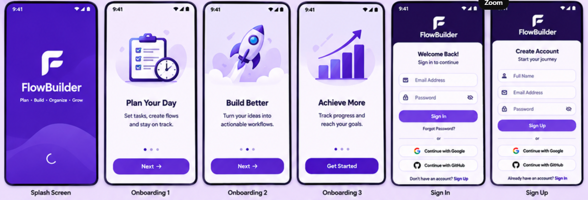
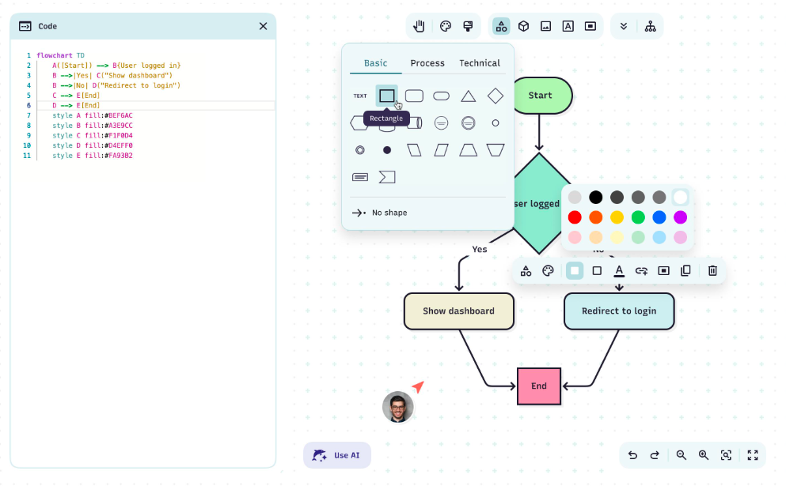
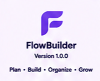
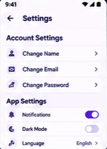
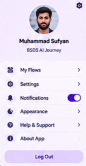

<p align="center">
  
</p>

<h1 align="center">FlowBuilder</h1>

<p align="center">
  <strong>Offline-first visual flowchart maker & algorithm diagram studio for Android.</strong>
  <br />
  Designed with Jetpack Compose, Material 3, automated DAG layouts, and multi-provider AI generation.
</p>

<p align="center">
  
  
  
  
  
  <a href="https://lavenderblush-monkey-546500.hostingersite.com/"></a>
</p>

---


## 📸 App Preview

<p align="center">
  
</p>

<p align="center">
  
  &nbsp;
  
  &nbsp;
  
  &nbsp;
  
</p>

---

## ⚡ Core Highlights

| Feature | Description |
| :--- | :--- |
| 🎨 **Dynamic Vector Canvas** | Infinite pan, smooth pinch-to-zoom (0.2x – 3.0x), reset viewport, and snap-to-grid with dots, lines, or cross grids. |
| 📐 **Smart Connectors** | Orthogonal 90° right-angle routing, smooth Bezier curves, and direct lines with multi-point anchor snapping. |
| 🤖 **Multi-Provider AI** | Built-in Gemini Flash via Firebase AI Logic, plus BYOK (Bring-Your-Own-Key) support for Groq, OpenRouter, and OpenAI. |
| 🔄 **Automatic DAG Layout** | Sugiyama-style hierarchical graph layout (Top-to-Bottom, Left-to-Right, Bottom-to-Top, Right-to-Left). |
| 🛡️ **Real-Time Validator** | Instant semantic diagnostics detecting orphaned nodes, unhandled decision branches, and cyclic traps. |
| 💾 **Offline-First Storage** | 100% local persistence using Room Database + SQLite, with optional cloud backup via Firestore. |
| 📤 **Multi-Format Export** | Render high-res PNGs (Light & Dark theme), print vector PDFs, or export editable JSON graphs. |

---

## 🧩 Comprehensive Shape Library

FlowBuilder includes a rich catalog of standard flow diagram shapes:

* **Core Shapes**: Terminator (Start/End Oval), Process (Rectangle), Decision (Diamond), Data I/O (Parallelogram)
* **Process & Control**: Subroutines, Delay timers, Preparation (Hexagon), Manual Input (Trapezoid)
* **Data & Storage**: Database cylinders, Document, Multi-Document, Internal Storage blocks
* **Connectors & Annotations**: On-page / Off-page circle connectors and freeform text blocks
* **Typography & Palette**: Custom fills, borders, and Google Fonts (*Jakarta Sans, Inter, Outfit, Space Grotesk, JetBrains Mono*)

---

## 🤖 AI Studio Features

FlowBuilder is designed for rapid algorithm prototyping:

1. **Prompt to Flowchart**: Describe an idea in plain English (e.g., *"Design an order refund flow with fraud check"*), and the AI builds the entire graph.
2. **Contextual Diagram Assistant**: Real-time sidekick chat that analyzes current nodes and suggests missing logic.
3. **Step Expansion**: Select any node to automatically elaborate it into sub-steps.
4. **Logic Diagnostics**: Instant natural language explanations for validation warnings and disconnected paths.

---

## 🏗 Tech Stack & Architecture

FlowBuilder is built adhering strictly to Clean Architecture and modern Android development best practices:

```
flowbuilder/
├── app/src/main/java/com/example/
│   ├── data/
│   │   ├── export/         # High-resolution PNG, PDF & JSON exporters
│   │   ├── local/          # Room DB entities, DAOs & EncryptedSharedPreferences
│   │   ├── remote/         # Firestore synchronization, App Check & AI APIs
│   │   └── repository/     # Repositories (FlowAiRepository, FlowProjectRepository)
│   ├── domain/
│   │   ├── engine/         # Geometry math, DAG LayoutEngine, FlowValidator & DSL
│   │   ├── model/          # Node, Edge, Graph, and Template schemas
│   │   └── templates/      # Built-in industry flowchart templates
│   ├── ui/
│   │   ├── auth/           # Onboarding, Splash & Authentication flows
│   │   ├── chat/           # AI diagram assistant chat interface
│   │   ├── components/     # Custom canvas renderers, shapes & path geometry
│   │   ├── editor/         # Canvas gesture view, toolbars & property sheets
│   │   ├── home/           # Project gallery & template selector
│   │   ├── profile/        # Preferences & local API key manager
│   │   └── theme/          # Material 3 styling, color roles & typography
│   └── viewmodel/          # MVI/MVVM UI StateFlow managers
```

### Key Libraries Used

* **UI**: Jetpack Compose BOM, Material 3, Accompanist, Coil
* **Persistence**: Room Database (with KSP compiler), AndroidX DataStore
* **Security**: Android Keystore & EncryptedSharedPreferences for API keys
* **Cloud & Auth**: Firebase Auth, Cloud Firestore, Firebase App Check, Firebase AI Logic
* **Serialization**: Moshi Kotlin Codegen

---

## 🏁 Getting Started

### Prerequisites

* **Android Studio**: Meerkat (2024.3+) or newer
* **JDK**: Version 17+
* **Target Device**: Android 7.0 (API Level 24) or higher

### Setup & Run

1. **Clone the repository**:
   ```bash
   git clone https://github.com/MuhammadSufyan-ux/FlowBuilder.git
   cd FlowBuilder
   ```

2. **Open in Android Studio**:
   - Open Android Studio, click **File > Open**, and select the `FlowBuilder` folder.
   - Allow Gradle to sync the project dependencies automatically.

3. **Configure Environment (Optional)**:
   - For custom backend or AI endpoints, create a `.env` file in the root directory:
     ```bash
     cp .env.example .env
     ```

4. **Launch the App**:
   - Select your target device or emulator and press **Run (`Shift + F10`)**.

---

## 📋 Built-In Templates

FlowBuilder comes with several ready-to-use workflows right out of the box:
* 🔐 **Login & Authentication**: Credential check, password retry loop, and dashboard routing.
* 🧮 **Algorithm Basics**: Two-number comparison and branch decision logic.
* 💳 **ATM Cash Withdrawal**: PIN verification, balance checks, and dispense logic.
* 📦 **E-Commerce Order Flow**: Inventory hold, payment gateway, packing, and dispatch.
* 🔄 **Software Development Life Cycle (SDLC)**: Agile cycle diagram with testing loops.

---

## 👨‍💻 Developer & Access

This application is developed by **Muhammad Sufyan**. All rights reserved.

For project access, inquiries, or collaborations, please visit:
* 🌐 **Portfolio**: [lavenderblush-monkey-546500.hostingersite.com](https://lavenderblush-monkey-546500.hostingersite.com/)